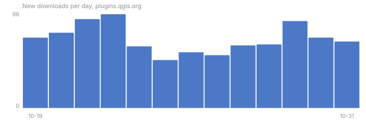

# AI Agent — public metrics

Collected once a day by `.github/workflows/metrics.yml` on `main` (`tools/collect_metrics.py`). Downloads come from plugins.qgis.org: a version's count includes updates, so the first days after a release roughly show how many installs are in use. Traffic is GitHub's own count of the repository.

## Downloads by version, 2026-10-21

| version | published | downloads |
| --- | --- | --- |
| 0.4.0 | 2026-10-17 | 200 |
| 0.3.0 | 2026-10-13 | 161 |
| 0.2.0 | 2026-10-04 | 506 |
| 0.1.1 | 2026-10-01 | 156 |
| 0.1.0 | 2026-09-01 | 881 |

## Last days

| day | total | new |
| --- | --- | --- |
| 2026-10-21 | 1904 | 91 |
| 2026-10-20 | 1813 | 77 |
| 2026-10-19 | 1736 | 72 |
| 2026-10-18 | 1664 | — |

## GitHub traffic

| day | views (unique) | clones (unique) |
| --- | --- | --- |
| 2026-10-20 | 1 (1) | 225 (49) |
| 2026-10-19 | 8 (2) | 160 (36) |
| 2026-10-18 | 3 (2) | 105 (27) |
| 2026-10-17 | 7 (1) | 195 (48) |
| 2026-10-16 | 24 (3) | 191 (44) |
| 2026-10-15 | 0 (0) | 245 (49) |
| 2026-10-14 | 1 (1) | 27 (12) |
| 2026-10-13 | 5 (2) | 465 (105) |
| 2026-10-12 | 0 (0) | 221 (54) |
| 2026-10-11 | 0 (0) | 12 (4) |
| 2026-10-10 | 0 (0) | 97 (34) |
| 2026-10-09 | 8 (3) | 64 (8) |
| 2026-10-08 | 2 (2) | 83 (35) |
| 2026-10-07 | 4 (2) | 272 (81) |
