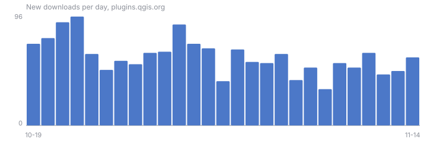

# AI Agent — public metrics

Collected once a day by `.github/workflows/metrics.yml` on `main` (`tools/collect_metrics.py`). Downloads come from plugins.qgis.org: a version's count includes updates, so the first days after a release roughly show how many installs are in use. Traffic is GitHub's own count of the repository.

## Downloads by version, 2026-11-04

| version | published | downloads |
| --- | --- | --- |
| 0.4.2 | 2026-10-26 | 392 |
| 0.4.1 | 2026-10-20 | 362 |
| 0.4.0 | 2026-10-17 | 293 |
| 0.3.0 | 2026-10-13 | 179 |
| 0.2.0 | 2026-10-04 | 516 |
| 0.1.1 | 2026-10-01 | 166 |
| 0.1.0 | 2026-09-01 | 890 |

## Last days

| day | total | new |
| --- | --- | --- |
| 2026-11-04 | 2798 | 55 |
| 2026-11-03 | 2743 | 56 |
| 2026-11-02 | 2687 | 67 |
| 2026-11-01 | 2620 | 39 |
| 2026-10-31 | 2581 | 68 |
| 2026-10-30 | 2513 | 72 |
| 2026-10-29 | 2441 | 89 |
| 2026-10-28 | 2352 | 65 |
| 2026-10-27 | 2287 | 64 |
| 2026-10-26 | 2223 | 54 |
| 2026-10-25 | 2169 | 57 |
| 2026-10-24 | 2112 | 49 |
| 2026-10-23 | 2063 | 63 |
| 2026-10-22 | 2000 | 96 |

## GitHub traffic

| day | views (unique) | clones (unique) |
| --- | --- | --- |
| 2026-11-03 | 1 (1) | 2 (2) |
| 2026-11-02 | 0 (0) | 3 (3) |
| 2026-11-01 | 0 (0) | 6 (4) |
| 2026-10-31 | 0 (0) | 11 (7) |
| 2026-10-30 | 0 (0) | 21 (11) |
| 2026-10-29 | 0 (0) | 3 (3) |
| 2026-10-28 | 1 (1) | 16 (5) |
| 2026-10-27 | 0 (0) | 21 (12) |
| 2026-10-26 | 9 (2) | 79 (14) |
| 2026-10-25 | 1 (1) | 10 (5) |
| 2026-10-24 | 0 (0) | 11 (6) |
| 2026-10-23 | 0 (0) | 3 (3) |
| 2026-10-22 | 0 (0) | 9 (5) |
| 2026-10-21 | 0 (0) | 81 (27) |
