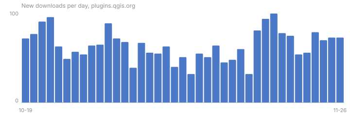

# AI Agent — public metrics

Collected once a day by `.github/workflows/metrics.yml` on `main` (`tools/collect_metrics.py`). Downloads come from plugins.qgis.org: a version's count includes updates, so the first days after a release roughly show how many installs are in use. Traffic is GitHub's own count of the repository.

## Downloads by version, 2026-11-28

| version | published | downloads |
| --- | --- | --- |
| 0.4.4 | 2026-11-10 | 891 |
| 0.4.2 | 2026-10-26 | 829 |
| 0.4.1 | 2026-10-20 | 386 |
| 0.4.0 | 2026-10-17 | 329 |
| 0.3.0 | 2026-10-13 | 205 |
| 0.2.0 | 2026-10-04 | 537 |
| 0.1.1 | 2026-10-01 | 194 |
| 0.1.0 | 2026-09-01 | 908 |

## Last days

| day | total | new |
| --- | --- | --- |
| 2026-11-28 | 4279 | 45 |
| 2026-11-27 | 4234 | 62 |
| 2026-11-26 | 4172 | 73 |
| 2026-11-25 | 4099 | 73 |
| 2026-11-24 | 4026 | 70 |
| 2026-11-23 | 3956 | 79 |
| 2026-11-22 | 3877 | 56 |
| 2026-11-21 | 3821 | 54 |
| 2026-11-20 | 3767 | 75 |
| 2026-11-19 | 3692 | 78 |
| 2026-11-18 | 3614 | 100 |
| 2026-11-17 | 3514 | 94 |
| 2026-11-16 | 3420 | 81 |
| 2026-11-15 | 3339 | 32 |

## GitHub traffic

| day | views (unique) | clones (unique) |
| --- | --- | --- |
| 2026-11-27 | 0 (0) | 25 (12) |
| 2026-11-26 | 0 (0) | 5 (5) |
| 2026-11-25 | 0 (0) | 14 (9) |
| 2026-11-24 | 9 (2) | 5 (4) |
| 2026-11-23 | 3 (2) | 9 (8) |
| 2026-11-22 | 0 (0) | 1 (1) |
| 2026-11-21 | 0 (0) | 16 (10) |
| 2026-11-20 | 1 (1) | 4 (3) |
| 2026-11-19 | 1 (1) | 17 (9) |
| 2026-11-18 | 0 (0) | 21 (11) |
| 2026-11-17 | 1 (1) | 26 (15) |
| 2026-11-16 | 1 (1) | 116 (22) |
| 2026-11-15 | 0 (0) | 2 (2) |
| 2026-11-14 | 1 (1) | 13 (9) |
